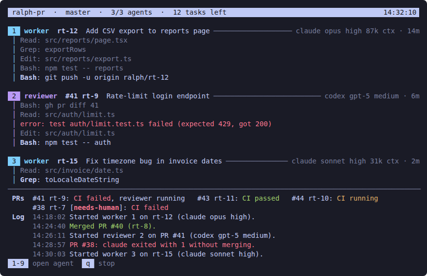

# ralph-afk

Unattended runners for [Ralph](https://github.com/subsy/ralph-tui) on a
[Beads](https://github.com/steveyegge/beads) backlog. When one agent runs out
of usage, they switch to another and wait for limits to reset.



| Command | What it does |
| --- | --- |
| `ralph` | One headless Ralph run on one epic. |
| `ralph-afk` | Works every ready epic, one task at a time, switching agents on usage limits. |
| `ralph-afk --pr` | Parallel workers (agents, or you), one PR per task; a reviewer agent, or you, merges once CI passes. |
| `ralph-afk --init` | One-time setup of a new project's checkout. |

## Requirements

- Git, Node.js, `jq`, GNU coreutils and util-linux (`timeout`, `flock`)
- [`ralph-tui`](https://github.com/subsy/ralph-tui) 0.12.0, on `PATH` or in `~/.bun/bin`
- [`bd`](https://github.com/steveyegge/beads) (Beads) and `bv` (used by Ralph's `beads-bv` tracker)
- `claude` and/or `codex`
- `--pr` only: `gh`, authenticated, and a GitHub remote with CI
- `--pr` with a Claude reviewer: the ponytail Claude Code plugin, for its
  `ponytail:ponytail-review` skill

## Setup

### Once per machine

Run in this repository:

```bash
ln -s "$PWD/bin/ralph" "$PWD/bin/ralph-afk" ~/.local/bin/

mkdir -p ~/.config/ralph-tui/plugins/trackers ~/.config/ralph-tui/templates
ln -s "$PWD/ralph-tui/config.toml" ~/.config/ralph-tui/
ln -s "$PWD/ralph-tui/plugins/trackers/beads-resume.js" ~/.config/ralph-tui/plugins/trackers/
ln -s "$PWD/ralph-tui/templates/beads.hbs" ~/.config/ralph-tui/templates/

cp agents.example agents   # then edit; ignored by Git
```

The linked files are global Ralph defaults; a project's
`.ralph-tui/config.toml` overrides them:

- `config.toml`: selects the `beads-resume` tracker, turns on Ralph's
  auto-commit (the Codex sandbox keeps `.git` read-only), turns off
  `fullAuto` (Codex rejects it).
- `beads-resume.js`: extends `beads-bv`. Retries unfinished tasks first and
  lets Ralph start with pending edits, which `--takeover` relies on. Exports a
  local JSONL snapshot; never runs `bd sync`.
- `beads.hbs`: the prompt each task runs with.

### Once per project

In the project's checkout, run `ralph-afk --init`. It runs `bd init` when
there is no `.beads/`, adds a `## Ralph runs` authorization to `AGENTS.md`
(steps 1 and 5 below) and prints what is left. It never overwrites a file, so
running it again is safe.

1. `bd init`.
2. Optional: `ralph-tui init` for a project `.ralph-tui/config.toml`, e.g. to
   set its default agent.
3. Optional: `.ralph-tui/agents` for project-specific agents or models (see
   [Which agents file is used](#which-agents-file-is-used)).
4. In Claude Code, run `/setup-matt-pocock-skills` with Beads as the tracker.
   It writes `docs/agents/issue-tracker.md` and `docs/agents/domain.md`. Add
   your ticket rules to `issue-tracker.md`: one epic per feature, tasks sized
   for one Ralph run, no full-suite gate tickets (`ralph-afk` makes those).
5. In `AGENTS.md`, authorize Ralph runs to implement, verify, close tasks and
   commit without asking. Otherwise agents stop for approval nobody gives.
   Name the project's test and format commands there too: the built-in `--pr`
   prompts point agents to them.
6. `--pr` only: set up CI on GitHub. Optional: override a prompt (see
   [Prompts](#prompts)).
7. Smoke test: `ralph --agent codex --iterations 1`.

## Agents file

One line per agent and stage: `stage|agent|model|effort`. See `agents.example`.
The file is the only list of agents: comment a line out to stop using that
agent.

| Field | Meaning |
| --- | --- |
| `stage` | `worker`: `ralph`, `ralph-afk`, `--pr` workers. `reviewer`: `--pr` reviewer only. |
| `agent` | `claude` or `codex`. Anything else is refused at start. |
| `model` | Work model, passed as `--model`. `RALPH_<AGENT>_MODEL` (e.g. `RALPH_CODEX_MODEL`) overrides it for `ralph` and `ralph-afk`. |
| `effort` | Reasoning effort for `--pr` agents; `-` keeps the CLI default. Ignored by `ralph` and `ralph-afk`. |

In `--pr` mode, line order within a stage is the fallback order.

An optional `workers|N` line sets the number of `--pr` workers, a whole
number from 1. The default is 3. `ralph` and `ralph-afk` without `--pr`
ignore it, as they ignore `reviewer` lines.

A `reviewer|human` line means you review the `--pr` PRs on GitHub yourself;
see [You as the reviewer](#you-as-the-reviewer). The other `reviewer` lines
are then ignored, so commenting out `reviewer|human` brings the AI reviewer
back.

A `worker|human` line means you write the code and `--pr` only reviews it;
see [You as the worker](#you-as-the-worker). No worker agent runs and
`workers|N` is ignored. Sequential `ralph-afk` ignores `worker|human` and
runs its other `worker` lines. `worker|human` with `reviewer|human` is
refused, since it leaves `--pr` nothing to do.

### Which agents file is used

The first match wins. It is the same for `ralph`, `ralph-afk` and `--pr`:

1. `RALPH_AGENTS`, if set. A relative path is resolved from the checkout root.
2. `.ralph-tui/agents` in the checkout root, if it exists.
3. `agents` in this repository, next to `bin/`.

The project file replaces the shared one; the two are not merged. The
launchers always `cd` to the checkout root first, so running from a
subdirectory still finds `.ralph-tui/agents`. `--pr` mode allows
uncommitted files under `.ralph-tui/`, so an uncommitted project agents file
does not block it.

### Probes

`ralph-afk` and `--pr` check an agent with a built-in probe
(`bin/ralph-probe.mjs`) before using it. The probe sends a one-word request to Claude Haiku
or `gpt-6-luna` at low effort, in `/tmp`. It costs almost nothing. It cannot
detect a limit that applies only to the work model.

## ralph

```bash
ralph                            # oldest ready epic, project's default agent
ralph my-epic --iterations 10
ralph --agent codex              # Codex, with its model from the agents file
ralph --agent codex --takeover   # stop the Ralph running here, then start
```

- Works from anywhere inside the checkout.
- `--agent <name>` without `--model` adds that agent's work model. The model
  in `.ralph-tui/config.toml` belongs to the project's default agent.
- `--takeover` stops the Ralph that holds this checkout's lock, after checking
  the lock matches a live Ralph on this host and checkout. Ralph gets 30 s,
  then its child agents get SIGTERM, then SIGKILL 5 s later. The task keeps
  its claim, so `beads-resume` recovers its edits. Old session files move to
  `.ralph-tui/reports/takeover-*`. Do not combine with `--force` or `--resume`.
- Other options pass through to `ralph-tui run --headless`.

## ralph-afk

Start once, in tmux or with `nohup`:

```bash
ralph-afk                          # every ready epic, oldest first
ralph-afk my-epic other-epic       # only these, in this order
RALPH_AFK_SCHEDULE='00-07=codex 07-24=claude,codex' ralph-afk
```

Each cycle:

1. Closes epics whose children are all closed (`bd epic close-eligible`),
   which unblocks their dependents.
2. Picks the first epic with a ready or in-progress task. An open parentless
   issue blocking one of its tasks (e.g. a bug filed mid-task) moves under the
   epic so Ralph can work it.
3. Probes the scheduled agents that have a `worker` line. It stays on the
   last agent used and switches only when that agent stops answering.
4. Runs `ralph --takeover --iterations 1` and waits.

- Epics are re-read before every task, so new or unblocked epics join the
  queue. Dependencies between epics set their order.
- One `ralph-afk` per checkout. Its first takeover stops any Ralph already
  running there, interactive ones included.
- If a task closes but its edits are left uncommitted (Ralph 0.12.0 headless
  does not report a failed auto-commit), `ralph-afk` commits them as
  `<type>: <id> <title>`. If a hook rejects that commit, it retries with
  `--no-verify`.
- When no epic has ready work, it creates a full-suite gate epic. The gate
  runs all test suites, fixes failures, and reviews commits since the last
  gate. It is created only if a task closed since the last gate, no gate is
  open, and you named no epics. Then `ralph-afk` stops.
- Ctrl+C once: finish and commit the current task, then exit. Twice: stop at
  once.

### Usage limits

Ralph's `fallbackAgents` is not used: Ralph 0.12.0 does not recognise
subscription limit errors and would retry a limited agent until its
iterations run out. `ralph-afk` probes instead:

- No agent answers: it sleeps until the earliest time one may be back, then
  probes all of them again.
- A limited agent counts as back 1 minute after its reported reset. Other
  failures (auth, network) count as back after `RALPH_AFK_WAIT` seconds.
- With several schedule windows, it also wakes on the hour, in case a new
  window brings a usable agent.
- A run that ends within 2 minutes without closing or blocking a task waits
  `RALPH_AFK_WAIT` seconds before the next try. This covers an instant limit,
  a startup failure or a crash.
- A running task is never probed. If it hits a limit, the run ends and the
  next agent resumes the task and its edits through `beads-resume`.

### Schedule

`RALPH_AFK_SCHEDULE` is a space-separated list of `FROM-TO=agents` windows in
local hours, agents tried in order. The default is `00-24=claude,codex`.

- No agent runs outside every window.
- Split windows that cross midnight: `22-24=codex 00-06=codex`.
- Read when a task starts; a running task is not interrupted at a boundary.
- An agent with no `worker` line is skipped. An agent other than `claude` or
  `codex` is refused at start.

## ralph-afk --pr

```bash
ralph-afk --pr
```

The agents file sets the worker count (`workers|N`, default 3) and the
agents. For only Codex, comment out the Claude lines; Codex then needs a
`reviewer` line too.

Each worker takes a ready task into its own worktree and branch, opens a PR
and waits for CI. One reviewer at a time reviews, fixes and squash-merges PRs
whose checks all passed. It takes first the PR whose task blocks the most open
tasks, counting the tasks those block in turn; the oldest PR on a tie.

- At start, the local default branch is pushed to `origin` so workers branch
  from your latest planning commits. A changed `.beads/issues.jsonl` is
  committed first. Any other uncommitted change outside `.ralph-tui/` stops the
  run. Commits you make on it later are pushed before the next worker
  branches.
- Out of work, it keeps running and checks for new tasks every
  `RALPH_PR_POLL` seconds, so tasks filed later start without a restart. Only
  Ctrl+C stops it.
- Worktrees: `../<repo>-pr/`. Agent logs: `.ralph-tui/pr-logs/`.
- Agent steps come in live; failed tool calls show as `error:`. `claude -p`
  writes its log only at exit, so Claude steps come from its live session
  transcript in `~/.claude/projects/` (or `$CLAUDE_CONFIG_DIR/projects/`).
  Codex steps are the lines Codex writes to its log.
- In a terminal, a dashboard fills the screen. The header shows busy workers,
  the reviewer, ready tasks and merges. Below it is one numbered panel per
  running agent: its task or PR, model, effort, context size,
  minutes so far and last 5 steps. At
  the bottom are the open PRs with their labels and CI state, then the
  supervisor log. A panel keeps its number while its agent runs.
  - A small terminal keeps everything readable. Header fields and long log
    lines wrap. A panel cuts its title before its agent and minutes. Panels
    lose steps and PRs lose lines before the newest 3 log lines leave the
    screen.
  - Colour marks state: workers cyan, the reviewer magenta, errors and
    failures red, passed CI and merges green, running CI yellow. Older steps
    are dim, so the newest stands out. The header turns yellow while
    stopping. `NO_COLOR` turns colour off.
  - `1`-`9` opens that agent full screen with all its steps; `↑`/`↓`
    scroll, `Esc` goes back.
  - `q` or Ctrl+C stops, the same as Ctrl+C below.
  - The supervisor log also goes to `.ralph-tui/pr-logs/ralph-pr.log`, since
    the dashboard closes when the run ends.
- Not in a terminal (stdout or stdin redirected, e.g. `nohup` or `> file`),
  it prints a plain log instead. Each step is one line, prefixed with its task
  or `review-<PR>`. While busy, a status block prints every `RALPH_PR_POLL`
  seconds: each running agent with its model, effort, context size,
  minutes so far and last step,
  then each open PR with its labels, CI state and the agent on it.
- Task order: parentless tasks first, then by epic age. Skips tasks labelled
  `gate:backlog`, `in-review` or `needs-human`. A `new-ui` task waits for a
  `Mockup:` line in its description.
- After a merge, the task closes and its branch and worktree are removed. The
  main checkout fast-forwards if it is on the default branch with no local
  changes.
- Every 5 merges, `slow-tests.yml` is dispatched. A failure files a fix task.
- Every worker and reviewer prompt ends with a catch-up rule: when the PR
  conflicts with the base, merge `origin/<base>` and push before waiting on CI.
  GitHub runs no CI on a conflicting PR, so without it the agent waits forever.
- A PR labelled `in-review` whose CI failed before any review gets
  `needs-human`, not a reviewer. To hand it back to a worker, remove both
  labels. Once a reviewer has started a PR, red CI goes back to the reviewer,
  up to 3 runs.
- A task or PR whose agent fails 3 times gets `needs-human`. Other work
  continues. These items are listed when it runs out of work and at the end.
  Failure counts survive a restart (`.ralph-tui/pr-logs/tries.json`) and reset
  when the task gets `needs-human`.
- A task labelled `in-review` whose PR is no longer open is checked on GitHub.
  If the PR merged while no reviewer was watching, the task closes as after a
  merge. If the PR was closed or never opened, the task gets `needs-human`.
- A failed `gh`, `bd` or `git` call during a check is logged and retried at the
  next check. The run does not stop.
- A limited agent is not probed again before its reported reset. The next
  line of the same stage takes over.
- Ctrl+C: as in sequential mode.
- When the supervisor dies any other way (`kill -9`, a closed terminal), each
  running agent and its child processes get SIGTERM within 2 s.

### Prompts

Workers and reviewers run with `prompts/pr-worker.md` and
`prompts/pr-reviewer.md` from this repository. A checkout's own
`.ralph-tui/pr-worker.md` or `.ralph-tui/pr-reviewer.md` replaces the
built-in one for that project; copy the built-in one there to start.

- The worker prompt fits any project: it reads the task, implements it, runs
  the tests the project's docs name, opens the PR and waits for green CI.
- The reviewer prompt makes a Claude reviewer review with the
  `ponytail:ponytail-review` skill (from the ponytail plugin), then fix and
  merge. Codex has no skills, so a Codex reviewer uses the prompt's checklist
  alone.

### You as the worker

With a `worker|human` line in the agents file, no worker agent runs and the
worker prompt is not used:

1. Pick a ready task, make a branch named after its ID (e.g. `TreeTutor-7t3`),
   push it and open a PR.
2. Once all its checks pass, the supervisor sets the task to `in_progress`,
   labels it `in-review` and the AI reviewer reviews, fixes and squash-merges
   it, as for a worker's PR. You add no labels.
3. After the merge the task closes and its branch is removed from `origin`
   and from your checkout, unless you have it checked out.

- A PR whose CI fails before a review just waits for you to fix it; it does
  not get `needs-human`.
- Uncommitted changes in your checkout do not stop the run, since no worker
  branches from it.
- The dashboard header says `worker you`.

### You as the reviewer

With a `reviewer|human` line in the agents file, no reviewer agent runs:

1. A worker works until CI passes and labels the task `in-review`, as usual.
2. The supervisor compacts the worker's Claude session (`/compact`), so later
   fixes start from a short context. Codex sessions are not compacted; Codex
   compacts itself near its limit.
3. The PR waits for you on GitHub. The dashboard header says `reviewer you`.
4. To accept it, merge it on GitHub. The task closes at the next check, and
   its branch and worktree are removed, as after an agent's merge.
5. To ask for changes, leave a review or comment on the PR. GitHub does not
   let you request changes on a PR opened with your own login, so a comment
   is enough. At the next check, the supervisor resumes the same worker
   session with your comments. It fixes them, pushes, waits for CI and goes
   back to step 2.

- Only comments newer than the last run count: newer than the worker's end,
  or than a fix's start. A comment posted while a fix runs gets its own fix.
- When the worker's agent cannot run now (limit, schedule) or its session
  failed to resume, a fresh worker gets the task prompt plus your comments.
- A fix that exits with an error counts as a failed run, as for workers. A fix
  that leaves CI red gets `needs-human`.
- Sessions are kept in `.ralph-tui/pr-logs/sessions.json`, so a restart still
  resumes them. A PR already in review when the run starts waits for your next
  comment and gets a fresh worker.

## Environment variables

| Variable | Default | Purpose |
| --- | --- | --- |
| `RALPH_AGENTS` | see [lookup](#which-agents-file-is-used) | Agents file path. |
| `RALPH_AFK_SCHEDULE` | `00-24=claude,codex` | Agents allowed per hour. |
| `RALPH_AFK_WAIT` | `600` | Seconds before re-probing an agent with no known reset. |
| `RALPH_<AGENT>_MODEL` | from agents file | Work model override for `ralph` and `ralph-afk`. |
| `RALPH_PR_POLL` | `120` | Seconds between `--pr` checks. |

## Workflow

Plan at the keyboard with [Matt Pocock's skills](https://github.com/mattpocock/skills)
in Claude Code (they write only docs and tickets), then let the runners build.

1. **Grill:** `/grill-with-docs`, describe the feature, answer the numbered
   questions in one message (`q1 yes q2 ...`). Decisions go to `GLOSSARY.md`
   and `docs/adr/`. For bigger work, `/wayfinder` maps open decisions as
   tickets and resolves them one by one.
2. **Spec:** `/to-spec` writes `docs/<feature>-spec.md`.
3. **Mockup (new UI only):** put a rough mockup at
   `docs/mockups/<issue-id>.html` or `.png`, label the ticket `new-ui`, add a
   `Mockup:` line to its description. Tweaks to the existing look need none.
4. **Ticket:** `/to-tickets` makes one Beads epic per feature, a child task per
   step, dependencies for order. Size each task for one Ralph run (one
   session, up to about 200k tokens); merge tiny tasks, split big ones.
5. **Walk away:** `ralph-afk` (or `ralph-afk --pr`) in tmux.
6. **Check back:**

   ```bash
   bd list --status blocked          # external blocker, noted in the task
   bd list --label needs-human       # --pr: tasks or PRs that failed 3 times
   cat .ralph-tui/progress.md        # what each task did
   ```

   Answer the notes, unblock tasks, run `ralph-afk` again.

Plan the next feature while `ralph-afk` works; new epics queue behind older
ones on the next cycle.

## Tests

```bash
node --test test/*.test.mjs
```

Runs the scripts against fake CLIs in a temporary checkout. No model calls;
reads `agents.example`, not your `agents`.
